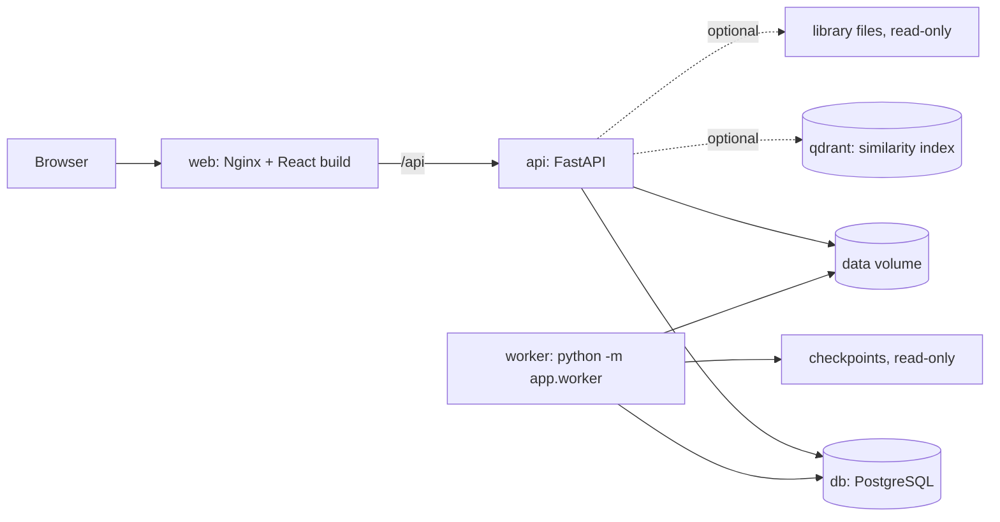
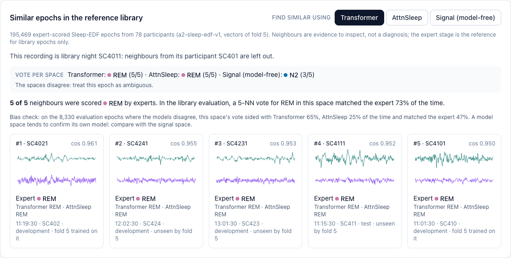

# A2 Sleep Staging — web app

Upload a Sleep-EDF recording, run the two models trained in Assignment 2 (a temporal
Transformer and AttnSleep, each a five-fold soft-voting ensemble), and inspect the result:
hypnogram, per-epoch waveform and probabilities, model-vs-model comparison, agreement with
an expert hypnogram, and CSV/JSON export.

Research prototype. Not a medical device and not for clinical use.


## Architecture



| Part | Stack |
|---|---|
| Frontend | React 19, TypeScript, Vite, TanStack Query, React Router, Tailwind CSS, Apache ECharts |
| API | FastAPI, Pydantic v2, SQLAlchemy 2, Alembic, PostgreSQL 17 |
| Worker | PyTorch (CPU), MNE, NumPy, SciPy; jobs claimed with `SELECT … FOR UPDATE SKIP LOCKED` |
| Tests | pytest (unit, parity, API against real PostgreSQL), Playwright (end-to-end) |
| Delivery | Docker Compose, GitHub Actions |

The API never imports PyTorch; the worker is the same image started with a different command.
PostgreSQL is the job queue, so job state lives in one place and survives restarts.

## Quick start

Requirements: Docker, and the trained checkpoints (next section).

```bash
cd A2/webapp
docker compose up --build
```

Open <http://localhost:8080>. A one-hour sample recording is preloaded: open it and press
**Run Transformer**. The interactive API reference is at <http://localhost:8080/api/docs>.

## Share from a Mac without renting a server

See [the Mac demo guide](docs/mac-demo.md) for an isolated app on port 8081 and a
public Cloudflare Quick Tunnel. No domain is needed. The demo uses separate
volumes from development; optional email OTP is available through cloudflared.

## Run on a server

See [the VPS guide](docs/vps.md) for an always-on server shared with other projects:
[`compose.vps.yaml`](compose.vps.yaml) publishes no ports, puts the site behind HTTP Basic
Auth, caps memory and CPU, and reaches the internet through one shared Cloudflare Tunnel.

## Checkpoints

The ten `.pt` files (about 22 MB) are **not** in Git. Each release directory under
`backend/checkpoints/` commits only a `manifest.json` with the constructor arguments, the
preprocessing parameters and the SHA-256 of every fold. Loading verifies the hashes.

```bash
cd backend
# You trained or received A2/runs/<Model>/sleep_waveform_final/fold_*.pt:
uv run python scripts/checkpoints.py package
# Or the files are hosted somewhere as <url>/<release id>/fold_N.pt:
uv run python scripts/checkpoints.py fetch --base-url <url>
uv run python scripts/checkpoints.py verify
```

Without checkpoints the app still starts; the models are shown as unavailable.
For UI work or CI, `scripts/checkpoints.py synthetic --out <dir>` writes random weights with
the real architectures. Point `CHECKPOINTS_DIR` at that directory; the UI flags such a build.

## Using it

1. **Upload** a PSG EDF with `EEG Fpz-Cz` and `EEG Pz-Oz` at 100 Hz (up to 64 MiB), optionally
   with its hypnogram, and pick the models to run. Other channels in the file are ignored.
2. **Wait** for the jobs; progress updates without reloading. A 23.5-hour Sleep-EDF night takes
   about one minute per model on an M3 Pro.
3. **Inspect**: click the hypnogram or use the ← → keys to move between epochs. The selected
   epoch and model are part of the URL, so a view can be shared.
4. **Export** each model's predictions as CSV, or as JSON with model and preprocessing provenance.

Anyone who can reach the app can upload, see and delete recordings — there is no login.
Uploads are removed after 30 days. Do not upload data that identifies a person.

## What the numbers mean

- Model cards show **published** metrics: the A2 held-out test participants, scored inside
  the benchmark window (30 minutes either side of sleep).
- The metrics panel shows agreement **on the recording you are viewing**, and only when a
  hypnogram was uploaded. Its scope switch selects every scored epoch or the benchmark window.
- Inference covers the whole file in consecutive 30-second epochs from its start, including
  long daytime wake that the models rarely saw in training.
- Reference labels are never read during inference; a test asserts that adding a hypnogram
  leaves the predictions unchanged.

## Parity with the research code

The serving code is a port of `A2/model_lib.py` and `A2/preprocessing.py`, checked on three levels:

| Check | Result | Runs in CI |
|---|---|---|
| Networks vs `A2/model_lib.py`, same weights and input | logits equal within 1e-6 | yes |
| Preprocessing vs `A2/preprocessing.prepare_waveforms` on the sample | arrays identical | yes |
| AttnSleep vs published run, night SC4031 (952 epochs) | max probability difference 4.8e-4; 952/952 labels equal | no |
| Transformer vs published run, night SC4031 (952 epochs) | 951/952 labels equal; the one flip has a top-two margin of 2e-4 | no |

The published run used CUDA and this app runs on CPU, so bitwise equality is not expected.
The last two rows need the trained checkpoints and the original night:

```bash
SLEEP_EDF_DIR=/path/to/sleep-cassette uv run pytest -m published
```

## Similar epochs (research)



For the selected epoch, the results page lists the nearest expert-scored epochs of a reference
library: every epoch the A2 models were evaluated on (195,469 epochs, 153 Sleep-cassette
nights, 78 participants). The researcher picks the space to search in, so retrieval can be
checked against the model that shaped it:

| Space | Vector | Shaped by |
|---|---|---|
| `transformer` | 128-d normalised CLS token, fold 5 | Transformer training labels |
| `attnsleep` | 2400-d flattened TCE output (`fc` input), fold 5 | AttnSleep training labels |
| `signal` | 12 log band powers (0.5–30 Hz, both channels), z-scored | nothing: model-free |

Five folds are five unrelated feature spaces, so one fold (5) spans both model spaces. Qdrant
holds the vectors as named vectors of one point per epoch (AttnSleep on disk, int8 in RAM) and
returns ids only; waveforms, expert stages and out-of-fold predictions are looked up by id in
the library files and the `library_epochs` table.

Neighbours are evidence to inspect, not a prediction: the expert stage is the reference for
library epochs only. Each neighbour shows its waveform, expert stage, out-of-fold model stages
and whether fold 5 trained on it. The panel adds the vote of every space, how often a vote for
that stage matched the expert in the library evaluation, and the bias check below.

How a search works:

- The worker saves, with every result, the fold-5 features of that model
  (`features_<model>_fold5.npy`) and the recording's band powers (`signal_features.npy`) next
  to the upload; at start it adds them to results that predate them. The API never loads
  PyTorch: it reads these files, asks Qdrant for ids and reads the rest from the library.
- A model space needs that model to have run on the recording; the signal space needs any job.
- An upload that is itself a library night (a re-uploaded Sleep-EDF file, or an excerpt cut
  on the 30 s grid such as the bundled sample) is recognised by band powers identical to a
  library night at a consistent epoch offset. Its participant is then excluded; otherwise the
  nearest neighbour would be the epoch itself, expert stage included.
- Without the library, Qdrant or the table the panel says what is missing and the rest of the
  app is unaffected.

Build the library once (about 50 minutes on 10 CPU cores), then start Qdrant with the stack:

```bash
cd A2/webapp
docker compose --profile similarity up -d db qdrant
cd backend
uv run alembic upgrade head
# Runs the serving pipeline on every night and stops unless it reproduces the A2 label file.
uv run python scripts/build_library.py extract \
    --edf-dir /path/to/sleep-cassette --labels /path/to/A2/dataset/sleep_waveform.csv
uv run python scripts/build_library.py index      # Qdrant collection a2-sleep-edf-v1-fold5
uv run python scripts/build_library.py load-db    # library_epochs table
uv run python scripts/build_library.py verify     # files, Qdrant and PostgreSQL agree
uv run python scripts/evaluate_library.py         # -> backend/library/library_eval.json
cd ..
docker compose --profile similarity up -d --build # api mounts LIBRARY_DIR (default backend/library)
```

The files (about 4.1 GB) are written to `backend/library/` and ignored by Git, except
`manifest.json` (provenance, hashes, signal statistics) and `library_eval.json`.
`evaluate_library.py` queries with the 60,462 epochs fold 5 never trained on and reports,
per space, precision@5 and a 5-NN vote scored against the expert stage, and, on epochs where
the two models disagree, which model each space's vote sides with.

| Space | Precision@5 | 5-NN vote accuracy / macro-F1 | On the 8,330 fold-5 disagreements: sides with Transformer / AttnSleep |
|---|---|---|---|
| `transformer` | 0.757 | 0.791 / 0.720 | 65% / 25% |
| `attnsleep` | 0.738 | 0.781 / 0.707 | 27% / 61% |
| `signal` | 0.686 | 0.729 / 0.642 | 40% / 38% |

For comparison, the fold-5 classifiers themselves score 0.803 / 0.750 (Transformer) and
0.798 / 0.749 (AttnSleep) on the same queries. Each model space mostly confirms its own model
when the two disagree, so retrieval in a model space is not independent evidence; the
signal space is neutral. When all three votes agree (69% of queries) they match the expert on
91%. HNSW recall@5 against exact search is 0.998–1.000.

`scripts/build_library.py synthetic --dir DIR` builds a 360-epoch library from the bundled
sample (the sample as night SC4031, plus two altered copies) with whatever checkpoints are
installed. The API tests and the CI end-to-end job use it; the UI flags it as synthetic.

## Development

Requirements: [uv](https://docs.astral.sh/uv/), Node 24, Docker (for PostgreSQL).

```bash
cd A2/webapp
docker compose up -d db

cd backend
uv sync
uv run alembic upgrade head
uv run fastapi dev app/main.py          # API on :8000, docs at /api/docs
uv run python -m app.worker             # in a second terminal

cd ../frontend
npm ci
npm run dev                             # UI on :5173, proxies /api to :8000
```

Run one recording without the web app:

```bash
uv run python -m app.ml.cli infer night-PSG.edf --model transformer-a2-v1 --out predictions.csv
```

After changing a route or schema, refresh the contract and the generated types:

```bash
(cd backend && uv run python scripts/export_openapi.py)
(cd frontend && npm run generate:api)
```

### Tests

```bash
cd backend
uv run ruff check .
uv run pytest                           # needs PostgreSQL; creates the sleep_test database

cd ../frontend
npm run lint
npm run build                           # type-check and bundle
npx playwright install chromium         # once
npm run test:e2e                        # against http://localhost:8080 (Docker Compose)
E2E_BASE_URL=http://localhost:5173 npm run test:e2e   # against the dev servers
```

The backend suite generates synthetic checkpoints, so it does not need the trained weights;
the similarity tests build a synthetic library and run Qdrant in-process. With the real
library and checkpoints, `uv run pytest -m published` also checks that the features served
for the bundled sample equal the library vectors of the same SC4031 epochs. The similarity
end-to-end tests skip when the stack has no searchable library.
Playwright keeps a trace, a screenshot and a video for every failing test
(`npx playwright show-report`).

## API

| Endpoint | Purpose |
|---|---|
| `GET /api/v1/models` | Model releases and their published metrics |
| `GET /api/v1/recordings` | All recordings with their jobs |
| `POST /api/v1/recordings` | Multipart upload: `edf`, optional `hypnogram`, optional `model_ids`. `201` new, `200` already stored |
| `GET /api/v1/recordings/{recording_id}` | One recording |
| `DELETE /api/v1/recordings/{recording_id}` | Delete an upload with its results (`204`) |
| `GET /api/v1/recordings/{recording_id}/epochs/{epoch_index}` | 30 s of filtered EEG at 100 Hz |
| `POST /api/v1/jobs` | Queue `{recording_id, model_id}` (`202`) |
| `GET /api/v1/jobs/{job_id}` | Status, stage, progress, error |
| `GET /api/v1/jobs/{job_id}/predictions` | Stage and five probabilities for every epoch |
| `GET /api/v1/jobs/{job_id}/metrics?scope=all\|benchmark` | Agreement with the hypnogram |
| `GET /api/v1/jobs/{job_id}/export?format=csv\|json` | Download |
| `GET /api/v1/library` | Similarity library, whether it can be searched, per-space evaluation |
| `GET /api/v1/recordings/{recording_id}/epochs/{epoch_index}/similar?space=…&k=5` | Nearest library epochs in `transformer`, `attnsleep` or `signal` |
| `GET /api/v1/library/epochs/{library_epoch_id}` | One library epoch with its 30 s waveform |
| `GET /api/health` | Database reachable, number of runnable models |

Errors use `{"detail": {"code": "EDF_MISSING_CHANNEL", "message": "…"}}`; the frontend and
the tests rely on `code`. A job is `queued → running → succeeded | failed`. Predictions and the
`succeeded` status are committed in one transaction, and a job found `running` when the worker
starts is marked `failed` with `INTERRUPTED` and can be run again.

## Layout

```text
webapp/
├── compose.yaml
├── compose.vps.yaml           server override (docs/vps.md); .env.vps.example
├── compose.demo.yaml          Mac demo (docs/mac-demo.md)
├── backend/
│   ├── app/
│   │   ├── main.py            FastAPI app
│   │   ├── worker.py          job loop
│   │   ├── models.py          SQLAlchemy tables
│   │   ├── schemas.py         Pydantic models
│   │   ├── core/              settings, database session
│   │   ├── api/               deps.py, routes/{recordings,jobs,models,library,health}.py
│   │   ├── services/          EDF validation, storage, metrics, exports
│   │   ├── library/           similarity search: files + Qdrant index, serving, metrics
│   │   └── ml/                preprocessing, inference, embeddings, signal features, networks/
│   ├── alembic/               migrations
│   ├── checkpoints/           manifests (committed) and fold_*.pt (ignored)
│   ├── library/               similarity library files (ignored) and its manifest/evaluation
│   ├── samples/               one-hour excerpt used as demo and test fixture
│   ├── scripts/               checkpoints.py, build_library.py, evaluate_library.py, …
│   └── tests/                 unit/, parity/, api/
├── frontend/
│   ├── nginx.conf             gateway; basic-auth.sh turns on Basic Auth at start-up
│   ├── src/                   api/, pages/, components/, charts/, lib/
│   └── tests/                 e2e/*.spec.ts, pages/ (page objects)
└── data/                      created at runtime, git-ignored
```

Limits and retention are environment variables; see `.env.example` and
`backend/app/core/config.py`.

## Data and licences

- The sample in `backend/samples/` is a one-hour, two-channel excerpt of night SC4031 from
  [Sleep-EDF Database Expanded](https://physionet.org/content/sleep-edfx/1.0.0/) (Kemp et al.,
  PhysioNet), distributed under the Open Data Commons Attribution License v1.0. Its participant
  is in the A2 held-out test split, so neither model was trained on it.
- `backend/app/ml/networks/attnsleep_author.py` is the AttnSleep authors' implementation
  (Eldele et al., 2021), MIT licence, unchanged.
