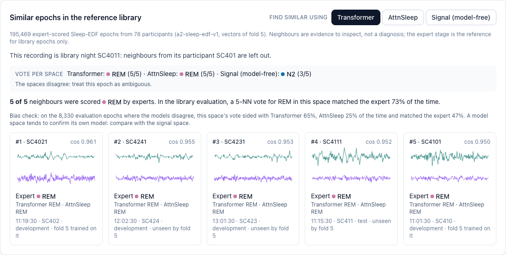

# Sleep EEG App · CO3133

Deep Learning and Its Applications, Semester 261, HCMUT. Course project site for
Assignments 1–3 (instructor: Lê Thành Sách).

## Sleep EEG App

**An interactive EEG sleep-staging app, with all application source under
[`A2/webapp/`](A2/webapp/README.md).** Upload a Sleep-EDF recording, run the temporal
Transformer and AttnSleep, and review five-stage predictions alongside the waveform.

- Explore hypnograms, per-epoch probabilities and disagreements between the two models.
- Compare predictions with an optional expert hypnogram and export CSV/JSON results.
- **Find the top 5 similar EEG epochs** in an expert-scored reference library, using
  Transformer embeddings, AttnSleep embeddings or model-free signal features. Each
  result shows its waveform, expert stage, model predictions and similarity score.
- Inspect cross-space votes and training-exposure flags; recognized library recordings
  exclude their own participant from search. Model-based similarity reflects the
  encoder's learned representation and is evidence for review, not an independent verdict.



**Stack:** React / TypeScript / Vite, FastAPI / PyTorch, PostgreSQL, Qdrant,
Docker Compose, pytest, Playwright and GitHub Actions.

[App setup and library build](A2/webapp/README.md) ·
[EEG research and reproduction](A2/README.md) ·
[Mac demo guide](A2/webapp/docs/mac-demo.md)

The application uses trained checkpoints and an optional reference library, installed
separately as described in the app README. GitHub Pages serves the course pages;
the API, worker, database and similarity index run as separate services.

## Site structure

Assignment 1 setup, saved-result checks and reproduction commands are in
[A1/README.md](A1/README.md). See the [A1 overall workflow](A1/docs/overall.md)
for the shared data pipeline, training loop, and model guides.

Assignment 2's notebook-first full-waveform preparation, training, saved-run
metadata and evaluation instructions are in [A2/README.md](A2/README.md).
The browser application is in `A2/webapp/`, alongside the research pipeline.
Assignment 3 currently has a [multimodal project page](assignment3.html);
its `A3/` code directory has not been created yet.

```
index.html          shared landing page (institution, course, group, AI disclosure)
assignment1.html     Assignment 1 page
assignment2.html     Assignment 2 page
assignment3.html     Assignment 3 page
style.css            shared stylesheet
pics/                images for the site (logo)
AI_USAGE.md          detailed AI-tool usage log
A1/                  Assignment 1: Fashion-MNIST code, configs, runs, notebook and docs
A2/                  Assignment 2: EEG sleep staging research and application
├── webapp/          Sleep EEG App source and deployment setup
│   ├── frontend/   React/TypeScript UI and Playwright tests
│   ├── backend/    FastAPI, worker, ML inference, migrations and pytest tests
│   ├── docs/       Application screenshots and Mac demo guide
│   └── compose.yaml
├── configs/         Research model configurations
├── sleep_exploration/  EDA and participant-fold manifests
├── runs/            Recorded research results and provenance
└── training.ipynb   Shared training/evaluation notebook
A3/                  Planned Assignment 3 code directory; not yet present
```

## Publish with GitHub Pages

1. Push these files to the root of your group's repository (`main` branch).
2. On GitHub: **Settings → Pages → Build and deployment → Source: Deploy from a branch**,
   then pick branch `main`, folder `/ (root)`, and save.
3. The site will be live at `https://<username>.github.io/<repo-name>/` within a few minutes.
4. Replace every `[bracketed placeholder]` in the HTML files with real group info
   (member names, student IDs, roles, GitHub profiles, repo link) before
   the Week 3 skeleton deadline (09 Sep 2026, 23:59 GMT+7).

## Before each milestone deadline

- Fill in the relevant assignment page's sections (dataset, methodology, results, etc.)
  — the `class="todo"` boxes mark what's still missing.
- Update the AI usage disclosure on the landing page, the relevant assignment page,
  and `AI_USAGE.md`.
- Confirm the repo also contains, per assignment: config files, seed settings,
  dependency versions, hardware info, and checkpoint access/reconstruction instructions.
- Double-check every link on the page actually resolves (repo, checkpoints, report/slides,
  YouTube video) before submitting on the LMS.

## Reference dates (GMT+7, handbook Sec. 7)

| Date | Milestone |
|---|---|
| 09 Sep 2026 | Group + Pages skeleton (this deliverable) |
| 23 Sep 2026 | A1 M1 Draft |
| 07 Oct 2026 | A2 M1 Proposal |
| 21 Oct 2026 | A1 M2 Final |
| 28 Oct 2026 | A2 M2 Draft |
| 11 Nov 2026 | A2 M3 Final |
| 18 Nov 2026 | A3 M1 Proposal |
| 25 Nov 2026 | A3 M2 Draft |
| 02 Dec 2026 | A3 M3 Final |

The project handbook takes precedence over the teaching plan on exact weight
breakdowns; check the LMS for any official updates.
